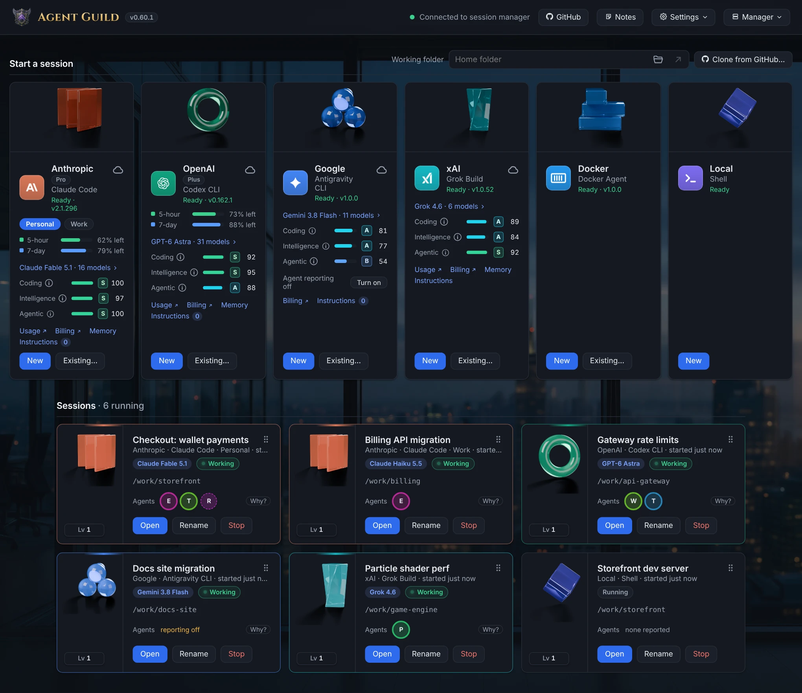
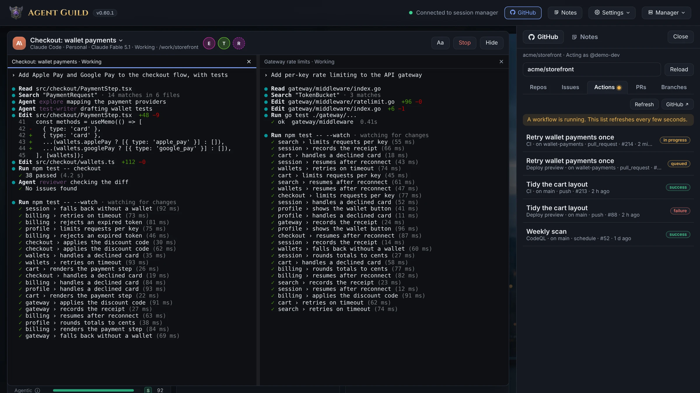
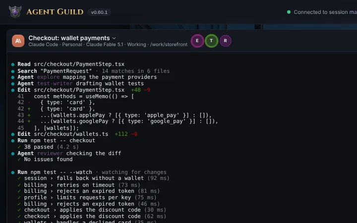
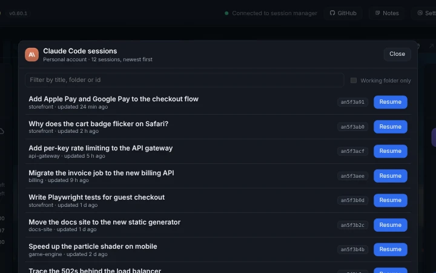
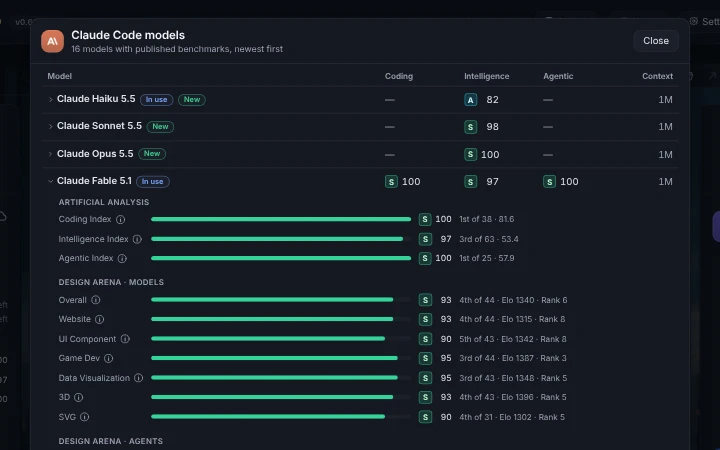
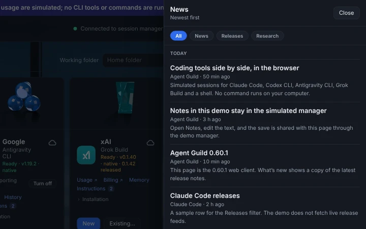
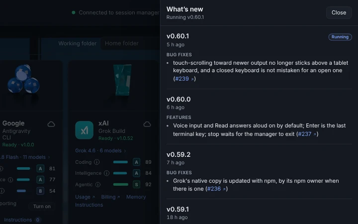
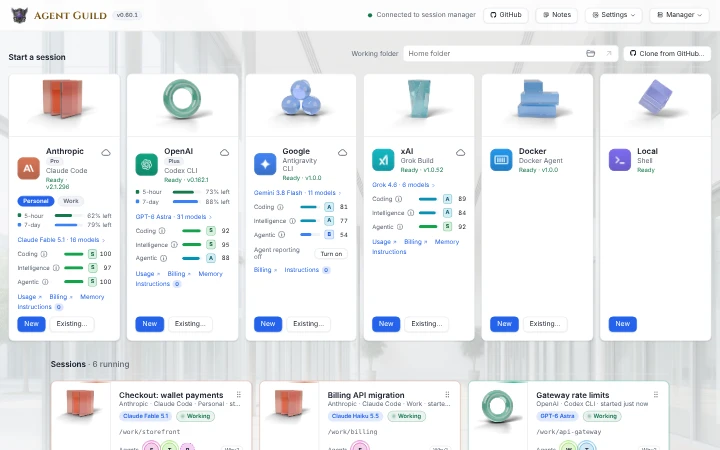

<h1 align="center">Agent Guild</h1>

<p align="center">
  <a href="https://www.npmjs.com/package/@oddessentials/agent-guild"></a>
  <a href="https://github.com/oddessentials/agent-guild/actions/workflows/release.yml"></a>
  
  
</p>

<p align="center"><strong>English</strong> · <a href="README.zh-CN.md">简体中文</a> · <a href="README.zh-TW.md">繁體中文</a></p>

**Run Claude Code, Codex CLI, Antigravity CLI, Grok Build, Docker Agent and
your own shells side by side in real terminals. Pick the same live sessions up
from your phone, VS Code or any browser. Free, on Windows, macOS and Linux.**

Agent Guild is a small manager that runs on your computer and serves one
local web page. Close the page whenever you like; the sessions keep running.

<a href="https://oddessentials.github.io/agent-guild/?view=yard&skin=guild&theme=dark"><picture>
  <source media="(prefers-reduced-motion: reduce)" srcset="docs/images/yard-still.webp">
  
</picture></a>

**[Try the demo](https://oddessentials.github.io/agent-guild/?view=yard&skin=guild&theme=dark)**:
walk the Yard in your browser. Simulated, free, no account and nothing installed.

## Quick start

<p align="center">
  <a href="https://github.com/oddessentials/agent-guild/releases/latest/download/agent-guild-windows-setup.exe"><picture><source media="(prefers-color-scheme: light)" srcset="docs/images/download-windows-light.webp"></picture></a>
  <a href="https://github.com/oddessentials/agent-guild/releases/latest/download/agent-guild-macos.pkg"><picture><source media="(prefers-color-scheme: light)" srcset="docs/images/download-macos-light.webp"></picture></a>
  <a href="https://github.com/oddessentials/agent-guild/releases/latest/download/agent-guild-linux-x64.tar.gz"><picture><source media="(prefers-color-scheme: light)" srcset="docs/images/download-linux-x64-light.webp"></picture></a>
  <a href="https://github.com/oddessentials/agent-guild/releases/latest/download/agent-guild-linux-arm64.tar.gz"><picture><source media="(prefers-color-scheme: light)" srcset="docs/images/download-linux-arm64-light.webp"></picture></a>
</p>

<p align="center"><sub>On Linux, extract the download and run <code>./install.sh</code>. · <a href="https://github.com/oddessentials/agent-guild/releases/latest">All downloads and checksums</a></sub></p>

Or install with npm, on Node.js 22 or newer:

```sh
npm install -g @oddessentials/agent-guild
agent-guild
```

The page opens in your browser. Press **New** on a tool's card to start a
session. Sign in to each tool inside its first session, as you would in any
terminal. To look around first, [try the demo](https://oddessentials.github.io/agent-guild/?view=yard&skin=guild&theme=dark)
(simulated, nothing installed) or [watch the trailer](https://www.youtube.com/watch?v=_vQuW0v-uMY).

**Or ask your agent.** Point it at
[the setup skill](https://github.com/oddessentials/agent-guild/blob/main/plugins/agent-guild/skills/setup-agent-guild/SKILL.md),
or run `claude plugin marketplace add oddessentials/agent-guild --sparse .claude-plugin plugins`
and `claude plugin install agent-guild@agent-guild`. It installs and checks Agent Guild,
then connects over [MCP](docs/mcp.md) to see and steer your sessions.

## Why Agent Guild

<picture>
  <source media="(prefers-color-scheme: light)" srcset="docs/images/overview-light.webp">
  
</picture>

* **The real CLIs, unchanged.** Each session is the tool itself in a real
  terminal, not a chat copy of it. Whatever sign-in the tool uses works: a
  subscription, an API key, Amazon Bedrock or your own gateway.
* **Every agent in one place.** Claude Code, Codex CLI, Antigravity CLI, Grok
  Build, Docker Agent, any shell, and tmux or herdr sessions, each card
  showing its helper agents and model, with usage meters for Claude Code and
  Codex CLI.
* **The same session on every screen.** Any browser, a phone over
  [Tailscale](#remote-access-with-tailscale) with touch keys, VS Code, and
  the Agent Guild app: iPhone, iPad and Apple Vision Pro on the
  [App Store](https://apps.apple.com/us/app/agent-guild-remote/id6825451331);
  Android, Android TV, Google TV and Android XR on
  [Google Play](https://play.google.com/store/apps/details?id=com.oddessentials.agentguild)
  or [GitHub](https://github.com/oddessentials/agent-guild-android/releases/latest);
  Fire tablets and Fire TV on the [Amazon Appstore](https://www.amazon.com/dp/B0HPLBDYPR);
  and Meta Quest on the [Meta Horizon Store](https://www.meta.com/experiences/1325496170657270/).
  Apple Watch and Meta Ray-Ban Display list your sessions and read a
  session's last answer aloud. See [what each screen needs](https://agentguild.oddessentials.ai/requirements/).
* **Native on Windows.** No WSL. Also macOS, Linux, and headless Linux
  servers over SSH.
* **Nothing in between.** No account and no relay server: the manager
  listens on `127.0.0.1`, and other devices reach it through your own
  Tailscale network or reverse proxy. See [Privacy](#privacy).

### How it compares

| | Agent Guild | tmux over SSH | Claude Code Remote Control |
| --- | --- | --- | --- |
| Agents | Any CLI, side by side | Any CLI | Claude Code |
| On a phone | The real terminal in a web page or app, with touch keys | An SSH app | A chat view in the Claude app |
| Sign-in | Whatever the tool uses | Whatever the tool uses | Pro, Max, Team or Enterprise; [not API keys, Bedrock or a gateway](https://code.claude.com/docs/en/remote-control) |
| Windows without WSL | Yes | No | Yes |

**Not yet:** push notifications. Phones and the Apple apps reconnect when you
open them again; the sessions keep running on the computer in the meantime.

**License:** open source under the [GNU AGPL 3.0](LICENSE). Free for
personal and commercial use.

## Requirements

| | |
| --- | --- |
| Node.js | 22 or newer |
| Windows | 10 version 1809 or later, x64 or arm64. No WSL needed. |
| macOS | 11 or later, Intel or Apple silicon |
| Linux | x64 or arm64 with glibc 2.28 or later (for example Debian 10, Ubuntu 20.04 or RHEL 8), with a desktop or over SSH |

No compiler is needed, except on Linux without glibc, such as Alpine:
`agent-guild` prints the commands that build its terminal library there. A
missing tool shows **Install** on its card; Antigravity CLI, which is not on
npm, shows its install command instead. For Docker Agent, see
[Docker Agent](#docker-agent).

**[Agent Guild for VS Code](https://marketplace.visualstudio.com/items?itemName=OddEssentials.agent-guild)**
opens the same page in an editor tab. Editors that install from Open VSX get it
[there](https://open-vsx.org/extension/OddEssentials/agent-guild).

## Setup

### Access token

You do not create one. The first run generates it, and `agent-guild` opens
the page with it. If a browser asks for it, open the link that
`agent-guild url` prints. Anyone with that link can use your terminals.

To replace it, stop the manager (this ends running sessions), delete
`auth-token` from the [data folder](docs/configuration.md#data-folder), and
start again.

### Docker Agent

Docker Agent is the `docker agent` plugin; Docker Desktop 4.63 and later ship
it, and its card's **Install** downloads the latest release into
`~/.docker/cli-plugins` when no copy runs. The card's installation box lists
every copy the Docker CLI finds and which one runs; the card updates and
removes only the downloaded one, and leaves Docker Desktop's to Desktop.

On Linux, Docker Engine does not include the plugin; the card's **Install**
adds it. The card needs Docker's own `docker` command: Podman's
`docker` and the Ubuntu snap of Docker do not load the plugin. If you
installed Docker Agent on its own as `docker-agent` (Homebrew or a release
download), add this to [`providers.json`](docs/configuration.md#providersjson),
then run `agent-guild restart`:

```json
{ "providers": [{ "id": "docker", "command": "docker-agent", "args": ["run"], "versionArgs": ["version"] }] }
```

### Headless Linux server

1. On the server:

   ```sh
   npm install -g @oddessentials/agent-guild
   agent-guild --no-browser
   ```

   It prints `Open: http://127.0.0.1:47821/#token=…`.

2. On your computer, open a tunnel and leave it open:

   ```sh
   ssh -L 47821:127.0.0.1:47821 you@server
   ```

3. Open the printed link in your browser. The local port must be `47821`;
   any other port is refused.

To start Agent Guild when the server boots, choose **Settings → Startup →
When the computer starts** in the page, then run once on the server:

```sh
sudo loginctl enable-linger $USER
```

This needs systemd and is not offered under WSL. `agent-guild status` shows
the result.

### Remote access with Tailscale

Use your terminals from a phone or another computer on your
[Tailscale](https://tailscale.com) network.

You need Tailscale 1.52 or later, signed in on both devices in the same
tailnet, with MagicDNS on.

1. In the page, choose **Settings → Remote access → Enable remote access**.
2. If it shows **Open Tailscale approval**, approve HTTPS there, then choose
   **Continue setup**.
3. If it says **Tailscale needs permission**, run the command under
   **Connection details** in a terminal allowed to manage Tailscale, then
   choose **Continue setup**.
4. Choose **Connect another device** and scan the QR code, or open the
   sign-in link, on the other device. On a TV or another device without a
   camera, enter your remote address in the Agent Guild app and approve the
   code it shows.

The sign-in link contains your access token. **Disable remote access** turns
it off; sessions keep running. On a headless server, do this through the SSH
tunnel above. For another reverse proxy, see
[configuration](docs/configuration.md#reverse-proxies).

### macOS keychain

The first Claude Code usage meter may ask for access to the
"Claude Code-credentials" keychain item. Choose **Always Allow**.

## Features

* Real terminals that survive closing or reloading the page
* Two terminals side by side with **Split**, a text size control, and
  **Copy…** to select terminal text
* Touch keys for phones and tablets: arrows, Tab, Enter, Esc, Ctrl+C,
  Paste and Clear
* **Dictate** into a terminal and **Read** the agent's last answer aloud
  (**Settings → Voice** and **Read aloud**)
* A working-folder picker with recent folders and a folder browser, and a
  button that opens the folder in your file manager
* Install and update each tool from its card, and upgrade Agent Guild from
  the page
* Helper agents and the model in use, shown on each card
  ([setup per tool](docs/agent-reporting.md))
* Rate-limit meters for Claude Code and Codex CLI
* Several accounts per tool ([accounts](docs/configuration.md#accounts))
* Model grades and benchmarks for each tool's models
* Resume a tool's earlier sessions with **Existing…**
* Read Google's saved conversations with **History**, filtered to the working folder
* See what Claude Code, Codex CLI and Grok Build remember with **Memory**, and
  which instruction files they and Antigravity CLI read in the working folder
  with **Instructions**
* GitHub issues, pull requests, workflow runs, branches and cloning
* The manager's environment on the Shell card: runtimes, design tools,
  Docker, and the versions a project pins
* Start the manager when you sign in, on Windows, macOS and Linux
* Shared notes, a news feed, skins, light and dark mode
* Alert sounds when the manager stops or an update is found
* **Videos**: Agent Guild's trailers and tutorials
* The Yard: your tools and sessions as a 3D world, one for each skin
* tmux and herdr sessions that keep running when the manager stops



### The Yard

For fun, the Yard shows your tools and sessions as a 3D world, one for each
skin. A double-click on a character opens its real terminal. The clip at the
top of this page shows it, and [the demo](https://oddessentials.github.io/agent-guild/?view=yard)
lets you try every skin.

<table>
  <tr>
    <td width="33%" align="center"><a href="docs/images/terminal.webp"></a><br><sub>Terminal</sub></td>
    <td width="33%" align="center"><a href="docs/images/history.webp"></a><br><sub>Resume an earlier session</sub></td>
    <td width="33%" align="center"><a href="docs/images/models.webp"></a><br><sub>Model benchmarks</sub></td>
  </tr>
  <tr>
    <td width="33%" align="center"><a href="docs/images/news.webp"></a><br><sub>News</sub></td>
    <td width="33%" align="center"><a href="docs/images/whats-new.webp"></a><br><sub>What's new</sub></td>
    <td width="33%" align="center"><a href="docs/images/overview-light.webp"></a><br><sub>Light mode</sub></td>
  </tr>
</table>

## Commands

| Command | What it does |
| --- | --- |
| `agent-guild` | Start the manager if needed and open the page. `--no-browser` prints the link instead. |
| `agent-guild status` | Show whether the manager is running and list its sessions. |
| `agent-guild stop` | Stop the manager and end every session. |
| `agent-guild restart` | Restart the manager on the installed version and end every session. |
| `agent-guild url` | Print the page link with the access token. |
| `agent-guild fireworks` | Launch fireworks over every open Yard. A coding agent in any terminal can run it too. |
| `agent-guild start` | Run the manager in the foreground. |
| `agent-guild doctor` | Diagnose the health of the installation and related tooling. |
| `agent-guild mcp` | Serve MCP on stdio, so a coding agent can see and steer the sessions. See [Agent Guild for agents](docs/mcp.md). |
| `agent-guild --version` | Print the installed Agent Guild version (`-v` or `version`). |

Sessions end when the manager stops or the computer restarts. tmux and herdr
sessions survive a manager stop.

After upgrading Agent Guild and restarting the manager, refresh every open
Agent Guild browser page to load the new frontend. Pages reconnect
automatically, but keep their loaded JavaScript until refreshed. Refreshing
is required for compatibility with the upgraded manager.

## Privacy

The manager listens on `127.0.0.1` only. Remote access goes through a private
Tailscale route or your own reverse proxy to that address. None of these
requests carry your code or prompts:

| To | For | How often |
| --- | --- | --- |
| npm registry, Homebrew, GitHub releases (Docker Agent) | Version checks | Hourly |
| Anthropic and OpenAI | Usage meters, with the tool's own sign-in | Every minute while the page is open |
| OpenRouter | Model list for benchmarks | Every 6 hours |
| News feeds, Hacker News, arXiv, GitHub | News feed | Every 30 minutes while the page is open |
| GitHub releases | What's new | Hourly, more often just after a release |
| herdr.dev, Homebrew | Multiplexer version checks | Hourly |
| GitHub, GitHub Status | GitHub panel | When you use it, and every few seconds while a workflow run you chose to watch is going |
| Package sources | Installs and updates | When you ask |
| YouTube | Video thumbnails and playback | When you open Videos |

Failed news, model list and release checks retry after 10 minutes.
`AGENT_GUILD_NO_UPDATE_CHECK=1` turns off version checks and self-upgrade.

## More

* [Agent Guild for agents](docs/mcp.md): the MCP server, and a plugin and skill that set Agent Guild up
* [Configuration](docs/configuration.md): add tools, accounts, environment variables, reverse proxies
* [Agent reporting](docs/agent-reporting.md): show agents from any tool
* [Skins](docs/SKINS.md): make your own look
* [Contributing](CONTRIBUTING.md)

## Agent Guild: World

[Agent Guild: World](https://store.steampowered.com/app/5462970/Agent_Guild_World/)
is a free, living 3D world for your AI coding agents, coming to Steam in
November 2026: six worlds to roam with a free camera, your own characters and
companions from the Steam Workshop, a Guild Board for your notes and to-dos,
and controller support, on Windows, macOS and Linux.
[Wishlist it on Steam](https://store.steampowered.com/app/5462970/Agent_Guild_World/).

## Follow

[YouTube](https://www.youtube.com/@Agent-Guild) ·
[X](https://x.com/agentguild_3d) ·
[Steam](https://store.steampowered.com/app/5462970/Agent_Guild_World/) ·
[Website](https://agentguild.oddessentials.ai/)

## Support

Agent Guild is free to use. If it saves you time,
[buy the lab a beer](https://oddessentials.ai/donate/?ref=agent-guild). It is a tip, not a
tax-deductible donation, and it changes nothing about the software.

## License

Copyright (c) 2026 Odd Essentials. Licensed under the
[GNU Affero General Public License 3.0](LICENSE).
