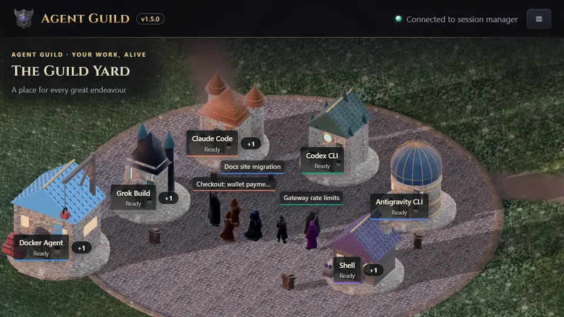
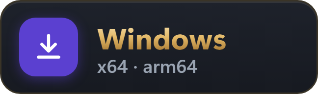
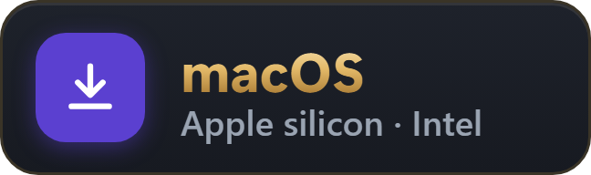

<h1 align="center">Agent Guild</h1>

<p align="center">
  
  <a href="https://www.npmjs.com/package/@oddessentials/agent-guild"></a>
  <a href="https://marketplace.visualstudio.com/items?itemName=OddEssentials.agent-guild"></a>
  <a href="https://apps.apple.com/us/app/agent-guild-remote/id6825451331"></a>
  <a href="https://play.google.com/store/apps/details?id=com.oddessentials.agentguild"></a>
  <a href="https://www.amazon.com/dp/B0HPLBDYPR"></a>
  <a href="https://www.meta.com/experiences/1325496170657270/"></a>
  <a href="https://store.steampowered.com/app/5462970/Agent_Guild_World/"></a>
</p>

<p align="center"><a href="README.md">English</a> · <strong>简体中文</strong> · <a href="README.zh-TW.md">繁體中文</a></p>

**你的智能体，你的世界，任何你能想象的风格。**

在真正的终端里并排运行 Claude Code、Codex CLI、Antigravity CLI、Grok Build、Docker Agent
和你自己的 shell，看着每个会话化身为生动 3D 世界里的角色干活：双击一个，就能打开它的真实终端。
在手机、VS Code 或任何浏览器上接着用同一批正在运行的会话。免费，支持 Windows、macOS 和 Linux。

Agent Guild 是一个运行在你电脑上的小管理器，提供一个本地网页。网页随时可以关掉，会话照常运行。

<a href="https://oddessentials.github.io/agent-guild/?view=yard&skin=guild&theme=dark"><picture>
  <source media="(prefers-reduced-motion: reduce)" srcset="docs/images/yard-still.webp">
  
</picture></a>

**[试玩演示](https://oddessentials.github.io/agent-guild/?view=yard&skin=guild&theme=dark)**：
在浏览器里逛一逛 Yard。模拟数据，免费，无需账号，什么都不用安装。

## 快速开始

**下载安装程序。** 自带 Node.js。

<p align="center">
  <a href="https://github.com/oddessentials/agent-guild/releases/latest/download/agent-guild-windows-setup.exe"><picture><source media="(prefers-color-scheme: light)" srcset="docs/images/download-windows-light.webp"></picture></a>
  <a href="https://github.com/oddessentials/agent-guild/releases/latest/download/agent-guild-macos-arm64.pkg"><picture><source media="(prefers-color-scheme: light)" srcset="docs/images/download-macos-light.webp"></picture></a>
  <a href="https://github.com/oddessentials/agent-guild/releases/latest/download/agent-guild-linux-x64.tar.gz"><picture><source media="(prefers-color-scheme: light)" srcset="docs/images/download-linux-x64-light.webp"></picture></a>
  <a href="https://github.com/oddessentials/agent-guild/releases/latest/download/agent-guild-linux-arm64.tar.gz"><picture><source media="(prefers-color-scheme: light)" srcset="docs/images/download-linux-arm64-light.webp"></picture></a>
</p>

<p align="center"><sub>Linux 上解压后运行 <code>./install.sh</code>。 · <a href="https://github.com/oddessentials/agent-guild/releases/latest/download/agent-guild-macos-x64.pkg">Intel 芯片的 Mac</a> · <a href="https://github.com/oddessentials/agent-guild/releases/latest">全部下载与校验和</a></sub></p>

**或者用 npm 安装**，需要 Node.js 22 或更新版本：

```sh
npm install -g @oddessentials/agent-guild
agent-guild
```

**或者交给你的智能体。** 把这句话粘贴给 Claude Code、Codex CLI 或任何编程智能体：

```text
Set up Agent Guild for me: https://agentguild.oddessentials.ai/agents/
```

它会安装并检查 Agent Guild，然后通过 [MCP](docs/mcp.md) 连接，查看并操控你的会话。
在 Claude Code 里也可以作为插件添加：
`claude plugin marketplace add oddessentials/agent-guild --sparse .claude-plugin plugins`，
然后运行 `claude plugin install agent-guild@agent-guild`。

网页会自动在浏览器中打开。在某个工具的卡片上按 **New** 即可启动会话。
每个工具在第一个会话里照常登录，和在任何终端里一样。[观看预告片](https://www.youtube.com/watch?v=_vQuW0v-uMY)，看看它实际运行的样子。

## 为什么选 Agent Guild

* **原版 CLI，原封不动。** 每个会话都是工具本身，跑在真实终端里，而不是聊天界面的复制品。
  工具支持的登录方式都能用：订阅、API key、Amazon Bedrock 或你自己的网关。
* **所有智能体，一处管理。** Claude Code、Codex CLI、Antigravity CLI、Grok Build、
  Docker Agent、任意 shell，以及 tmux 或 herdr 会话。Claude Code、Codex CLI 和
  Grok Build 可以同时登录多个账号；Claude Code 和 Codex 账号的用量上限实时可见。
* **同一个会话，每块屏幕。** 任何浏览器；通过 Tailscale 在手机上使用，带触屏按键；VS Code；
  以及上方各应用商店里适用于手机、平板、电视和头显的 Agent Guild 应用，Android 版也可从
  [GitHub](https://github.com/oddessentials/agent-guild-android/releases/latest) 获取。
  Apple Watch 和 Meta Ray-Ban Display 会列出你的会话，并朗读某个会话的最后一条回答。
* **Yard：看着它们干活。** 每个会话都是 3D 世界里的一个角色。等你回复的会被标出来；
  CI 通过时 Yard 会放烟花。双击任何一个角色，就能打开它的真实终端直接输入。
* **原生支持 Windows。** 无需 WSL。也支持 macOS、Linux，以及通过 SSH 使用的无头 Linux 服务器。
* **中间没有任何东西。** 不需要账号，没有中转服务器。其他设备通过你自己的 Tailscale
  网络或反向代理访问。开启远程访问后，拿到二维码或链接的人都能使用你的终端。

尚未支持：推送通知。

完整的功能、设置和命令说明见 [英文 README](README.md)。

## 链接

* 网站：https://agentguild.oddessentials.ai
* 各设备的要求：https://agentguild.oddessentials.ai/requirements/
* App：[App Store](https://apps.apple.com/us/app/agent-guild-remote/id6825451331) · [Google Play](https://play.google.com/store/apps/details?id=com.oddessentials.agentguild) · [Amazon Appstore](https://www.amazon.com/dp/B0HPLBDYPR) · [Meta Horizon Store](https://www.meta.com/experiences/1325496170657270/) · [GitHub 上的 Android 版](https://github.com/oddessentials/agent-guild-android/releases/latest)
* VS Code：[Marketplace](https://marketplace.visualstudio.com/items?itemName=OddEssentials.agent-guild) · [Open VSX](https://open-vsx.org/extension/OddEssentials/agent-guild)（Cursor、Windsurf 等编辑器）
* [Agent Guild: World](https://store.steampowered.com/app/5462970/Agent_Guild_World/)：Steam 上的 3D 世界
* YouTube：https://www.youtube.com/@Agent-Guild
* X：https://x.com/agentguild_3d

以 [GNU AGPL 3.0](LICENSE) 开源。
