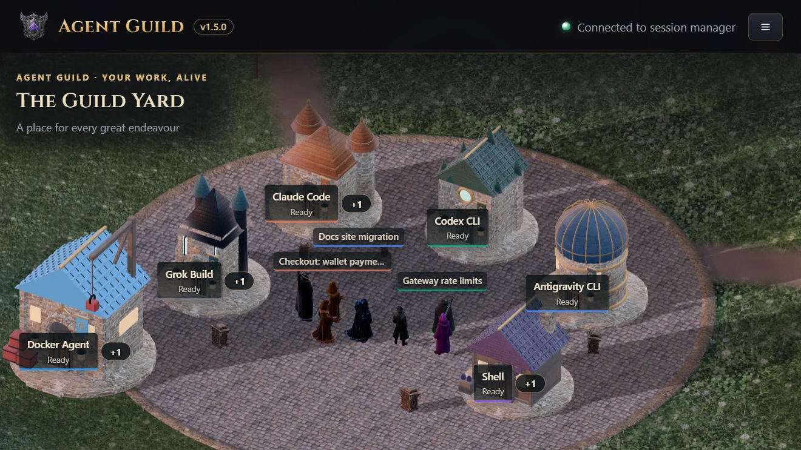
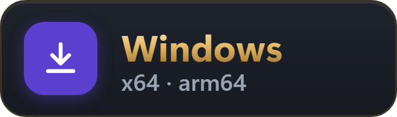
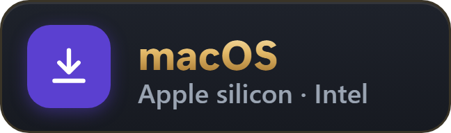
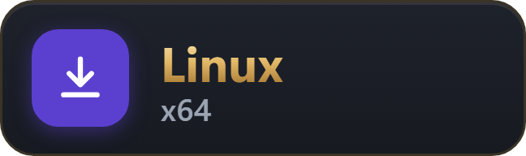
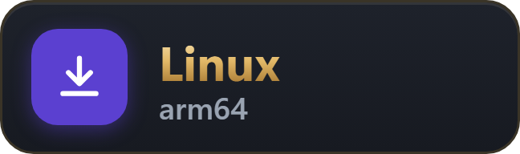

<h1 align="center">Agent Guild</h1>

<p align="center"><a href="README.md">English</a> · <a href="README.zh-CN.md">简体中文</a> · <strong>繁體中文</strong></p>

**在你自己的電腦上，用真正的終端機並排執行 Claude Code、Codex CLI、Antigravity CLI、
Grok Build、Docker Agent 和你自己的 shell。在手機、VS Code 或任何瀏覽器上接著使用同一批
正在執行的工作階段。免費，支援 Windows、macOS 和 Linux。**

Agent Guild 是一個在你電腦上執行的小型管理程式，提供一個本機網頁。網頁隨時可以關掉，工作階段照常執行。

<a href="https://oddessentials.github.io/agent-guild/?view=yard&skin=guild&theme=dark"><picture>
  <source media="(prefers-reduced-motion: reduce)" srcset="docs/images/yard-still.webp">
  
</picture></a>

**[試玩展示](https://oddessentials.github.io/agent-guild/?view=yard&skin=guild&theme=dark)**：
在瀏覽器裡逛逛 Yard。模擬資料，免費，不需要帳號，什麼都不用安裝。

## 快速開始

<p align="center">
  <a href="https://github.com/oddessentials/agent-guild/releases/latest/download/agent-guild-windows-setup.exe"><picture><source media="(prefers-color-scheme: light)" srcset="docs/images/download-windows-light.webp"></picture></a>
  <a href="https://github.com/oddessentials/agent-guild/releases/latest/download/agent-guild-macos-arm64.pkg"><picture><source media="(prefers-color-scheme: light)" srcset="docs/images/download-macos-light.webp"></picture></a>
  <a href="https://github.com/oddessentials/agent-guild/releases/latest/download/agent-guild-linux-x64.tar.gz"><picture><source media="(prefers-color-scheme: light)" srcset="docs/images/download-linux-x64-light.webp"></picture></a>
  <a href="https://github.com/oddessentials/agent-guild/releases/latest/download/agent-guild-linux-arm64.tar.gz"><picture><source media="(prefers-color-scheme: light)" srcset="docs/images/download-linux-arm64-light.webp"></picture></a>
</p>

<p align="center"><sub>Linux 上解壓縮後執行 <code>./install.sh</code>。 · <a href="https://github.com/oddessentials/agent-guild/releases/latest/download/agent-guild-macos-x64.pkg">Intel 晶片的 Mac</a> · <a href="https://github.com/oddessentials/agent-guild/releases/latest">所有下載與總和檢查碼</a></sub></p>

或者用 npm 安裝，需要 Node.js 22 或更新版本：

```sh
npm install -g @oddessentials/agent-guild
agent-guild
```

網頁會自動在瀏覽器中開啟。在某個工具的卡片上按 **New** 就能啟動工作階段。
每個工具在第一個工作階段裡照常登入，和在任何終端機裡一樣。

**或者交給你的代理。** 讓它讀取
[安裝技能](https://github.com/oddessentials/agent-guild/blob/main/plugins/agent-guild/skills/setup-agent-guild/SKILL.md)，
它會安裝並檢查 Agent Guild，然後透過 [MCP](docs/mcp.md) 連線，查看並操控你的工作階段。

## 為什麼選 Agent Guild

* **原版 CLI，原封不動。** 每個工作階段都是工具本身，跑在真實的終端機裡，而不是聊天介面的複製品。
  工具支援的登入方式都能用：訂閱、API 金鑰、Amazon Bedrock 或你自己的閘道。
* **所有代理，一處管理。** Claude Code、Codex CLI、Antigravity CLI、Grok Build、
  Docker Agent、任何 shell，以及 tmux 或 herdr 工作階段。Claude Code、Codex CLI 和
  Grok Build 可以同時登入多個帳號；Claude Code 和 Codex 帳號的用量上限即時可見。
* **同一個工作階段，每個螢幕。** 任何瀏覽器；透過 Tailscale 在手機上使用，附觸控按鍵；
  VS Code；以及 Agent Guild App：iPhone、iPad 和 Apple Vision Pro（[App Store](https://apps.apple.com/us/app/agent-guild-remote/id6825451331)），
  Android、Android TV、Google TV 和 Android XR（[Google Play](https://play.google.com/store/apps/details?id=com.oddessentials.agentguild)），Fire 平板和 Fire TV
  （[Amazon Appstore](https://www.amazon.com/dp/B0HPLBDYPR)），[Meta Horizon Store](https://www.meta.com/experiences/1325496170657270/)。Apple Watch 和 Meta Ray-Ban Display
  會列出你的工作階段，並朗讀某個工作階段的最後一則回答。
* **Yard：看著它們工作。** 每個工作階段都是 3D 世界裡的一個角色。等你回覆的會被標示出來；
  CI 通過時 Yard 會放煙火。雙擊任何一個角色，就能開啟它的真實終端機直接輸入。
* **原生支援 Windows。** 不需要 WSL。也支援 macOS、Linux，以及透過 SSH 使用的無頭 Linux 伺服器。
* **中間沒有任何東西。** 不需要帳號，沒有中繼伺服器。其他裝置透過你自己的 Tailscale
  網路或反向代理連線。開啟遠端存取後，拿到 QR code 或連結的人都能使用你的終端機。

尚未支援：推播通知。

完整的功能、設定和指令說明請見 [英文 README](README.md)。

## 連結

* 網站：https://agentguild.oddessentials.ai
* 各裝置的需求：https://agentguild.oddessentials.ai/requirements/
* App：[App Store](https://apps.apple.com/us/app/agent-guild-remote/id6825451331) · [Google Play](https://play.google.com/store/apps/details?id=com.oddessentials.agentguild) · [Amazon Appstore](https://www.amazon.com/dp/B0HPLBDYPR) · [Meta Horizon Store](https://www.meta.com/experiences/1325496170657270/) · [GitHub 上的 Android 版](https://github.com/oddessentials/agent-guild-android/releases/latest)
* VS Code：[Marketplace](https://marketplace.visualstudio.com/items?itemName=OddEssentials.agent-guild) · [Open VSX](https://open-vsx.org/extension/OddEssentials/agent-guild)（Cursor、Windsurf 等編輯器）
* [Agent Guild: World](https://store.steampowered.com/app/5462970/Agent_Guild_World/)：Steam 上的 3D 世界
* YouTube：https://www.youtube.com/@Agent-Guild
* X：https://x.com/agentguild_3d

以 [GNU AGPL 3.0](LICENSE) 開源。
